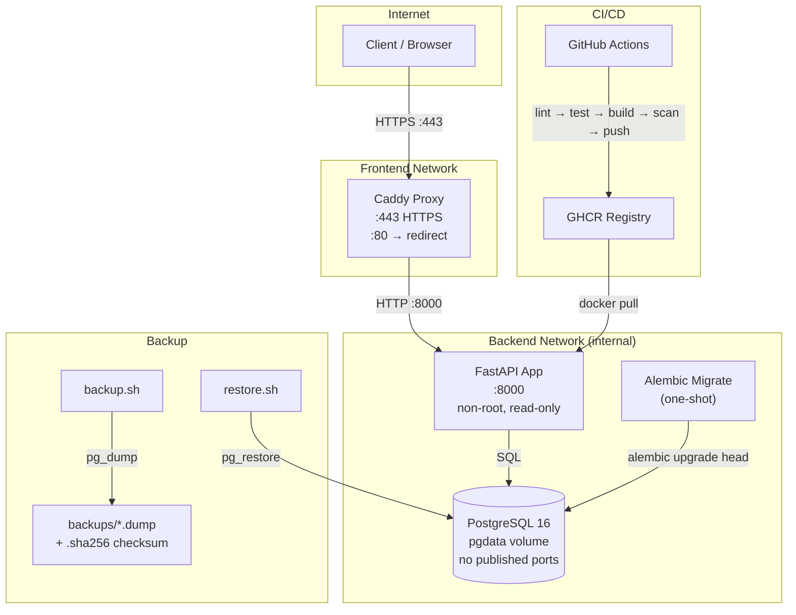

# Architecture

## System Diagram

## Component Table

| Component | Technology | Purpose |
|-----------|-----------|---------|
| API | FastAPI + Uvicorn | HTTP API server |
| Database | PostgreSQL 16 | Persistent data store |
| ORM | SQLAlchemy 2.x | Database access layer |
| Migrations | Alembic | Schema version control |
| Auth | PyJWT + argon2-cffi | JWT tokens + password hashing |
| Logging | structlog | Structured JSON logs |
| Proxy | Caddy 2 | TLS termination, security headers |
| Container | Docker + Compose | Packaging and orchestration |
| CI/CD | GitHub Actions | Automated pipeline |
| Registry | GHCR | Container image registry |

## Security Controls

1. **Non-root container** (UID 10001) — limits blast radius
2. **Read-only filesystem** — prevents runtime modifications
3. **Capabilities dropped** (`cap_drop: ALL`) — principle of least privilege
4. **No published DB port** — database only on internal network
5. **Secrets via files** (`*_FILE` convention) — not in env vars or docker inspect
6. **Partial unique index** — DB-level double-booking prevention
7. **Trivy scanning** — image vulnerability detection in CI
8. **Gitleaks** — secret scanning in CI
9. **SBOM generation** — software bill of materials
10. **Cosign signing** — image provenance verification
11. **Pinned versions** — reproducible builds
12. **HTTPS with security headers** — HSTS, X-Content-Type-Options, X-Frame-Options

## Network Boundaries

- **Frontend network**: Caddy (public ports 80/443) ↔ App (no published ports)
- **Backend network** (internal): App ↔ DB ↔ Migrate (no external access)
- **DB isolation**: PostgreSQL has no published ports and is only on the backend network
